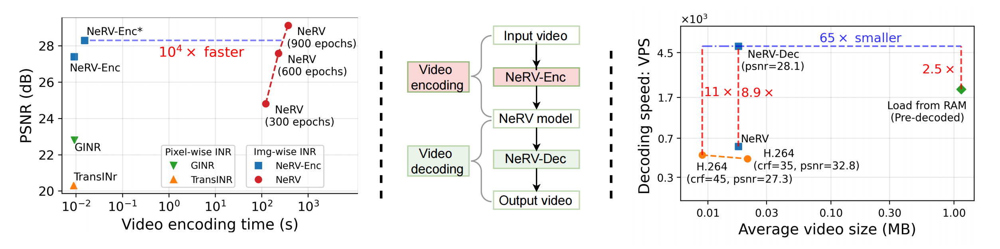
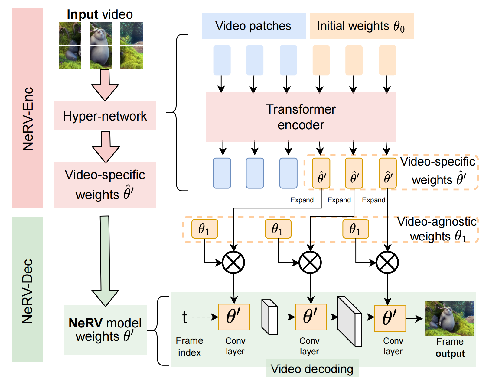
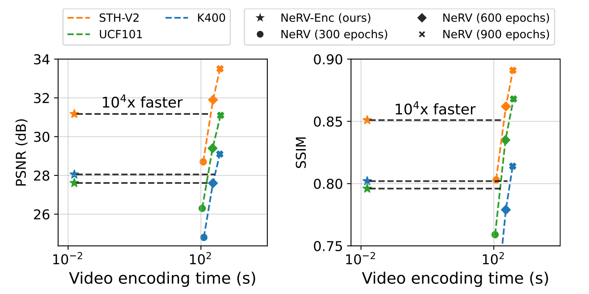
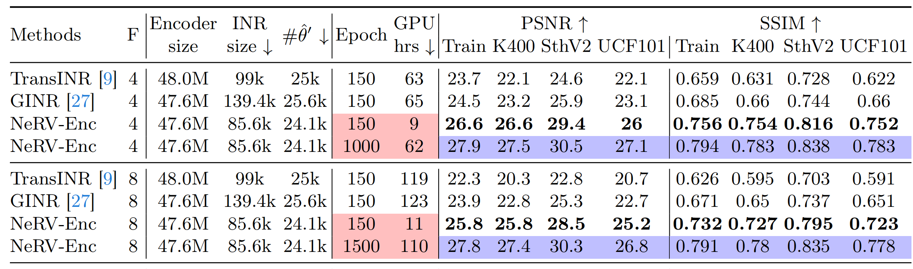
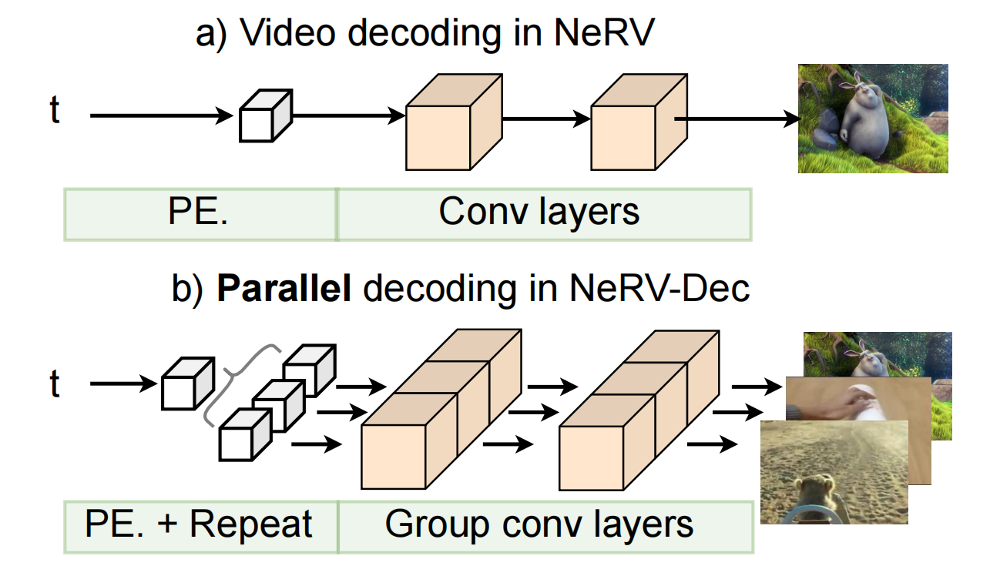
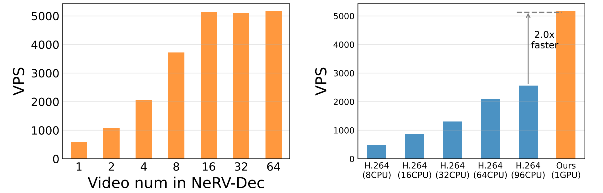

This repository contains the official implementation of the following paper. It is open-sourced for reproduction and research purposes, and may be polished further in the future.

**Fast Encoding and Decoding for Implicit Video Representation (ECCV 2024)**  
[Paper](https://arxiv.org/abs/2409.19429)


[Hao Chen](https://haochen-rye.github.io), 
Saining Xie,
Ser-Nam Lim,
[Abhinav Shrivastava](http://www.cs.umd.edu/~abhinav)

<!-- Framework Section -->
<h3>Framework</h3>
<p float="left">
  
</p>

<!-- Fast Encoding Section -->
<h3>Fast Encoding</h3>
<p float="left">
  
  
  
</p>

<!-- Fast Decoding Section -->
<h3>Fast Decoding</h3>
<p float="left">
  
  
</p>


<!-- Project page: https://yinboc.github.io/trans-inr/. -->

<!-- ```
@inproceedings{chen2023hypernerv,
  title={Transformers as Meta-Learners for Implicit Neural Representations},
  author={Chen, Yinbo and Wang, Xiaolong},
  booktitle={European Conference on Computer Vision},
  year={2022},
}
``` -->

## Reproducing Experiments
## Get started
We run with Python 3.8, you can set up a conda environment with all dependencies like so:
```
pip install -r requirements.txt 
```

### Training HyperNeRV
You can train HyperNeRV with below command, ```'train_dataset.args.cls_vid_num'``` specify the training dataset size.
```
python run_trainer.py --cfg cfgs/nerv_enc.yaml -w \
  --csv_file k400_short128.csv --out_path outputs/dbg/330_na0  \
    --frame_num 16 --t_duration 1.0 --input_size 128  \
    -b 16 --tag 327_na0_01_PE_ETrue_NTrue_Outneg_init1_Repeat-2 -p 5200 \
    -j 32 --opts train_dataset.args.cls_vid_num 20_20 \
    zero_center True     train_dataset.args.resize False   \
    train_dataset.args.rand_flip True  \
    model.args.tokenizer.args.patch_t 1   \
    model.args.tokenizer.args.patch_hw 32  \
    model.args.tokenizer.args.learn_pe True   \
    model.args.hyponet.args.out_bias 0   \
    model.args.hyponet.args.out_range neg  \
    model.args.hyponet.args.strds 4_8_2_2   \
    model.args.hyponet.args.ks 1_3   \
    model.args.hyponet.args.act gelu   \
    model.args.hyponet.args.hid_dim 64  \
    model.args.hyponet.args.pos_embed inr_1024  \
    model.args.hyponet.args.pe_dim 16   \
    model.args.hyponet.args.learn_pe True  \
    model.args.nerv_tokens.token_nums 0_64_0_0  \
    model.args.nerv_tokens.token_dims 1024_1152_1152_1152  \
    model.args.nerv_tokens.token_init_std 1  \
    model.args.nerv_tokens.z_type nerv \
    model.args.nerv_tokens.z_dim 256  \
    model.args.nerv_tokens.z_norm bn_bn  \
    model.args.nerv_tokens.z_norm_first False  \
    model.args.nerv_tokens.repeat_dim -2   \
    model.args.kl_layer.deterministic False  \
    model.args.kl_layer.kl_weight 1.5e-06   \
    model.args.kl_layer.avg_kl False  \
    model.args.transformer_encoder.name ViT-B  \
    model.args.transformer_encoder.proj_drop 0 \
    model.args.transformer_encoder.attn_drop 0  \
    model.args.transformer_encoder.mlp_drop 0  \
    optimizer.name adamw \
    optimizer.args.lr 0.0001 \
    optimizer.lr_type step   \
    optimizer.epoch_cycles 1  \
    optimizer.cycle_decay 1 \
    optimizer.full_cosine False \
    optimizer.loss_weights 1_0_0  \
    vis_epoch 15 vis_n 16 resume_ckt no dump_pred no dump_vid_grid yes  \
    eval_epoch 15  max_epoch 150 save_epoch 30 
```

Baseline command for training NeRV from scratch.
```
python projects/nerv_baseline/train_hypoconv.py -e 100 \
    --vid_path '/fs/vulcan-datasets/kinetics/val_256_new/cracking_neck/-SdZ6USVLi4.mp4' \
    --vid k400_01 --crop_size 128 --hid_dim 32 --strds 8 4 2 2 --ks 1 3 \
    --pe_dim 16 --pe_sigma 1024 --act gelu --out_bias tanh -b 2 --lr 0.001 \
    --eval_freq 50  --frames 8 --outf 302_e100_N8 
```

<p>If you find our work useful, please consider citing our paper:</p>

<pre><code>@article{chen2024fastnerv,
  title={Fast Encoding and Decoding for Implicit Video Representation},
  author={Chen, Hao and Xie, Saining and Lim, Ser-Nam and Shrivastava, Abhinav},
  journal={ECCV},
  year={2024}
}
</code></pre>
